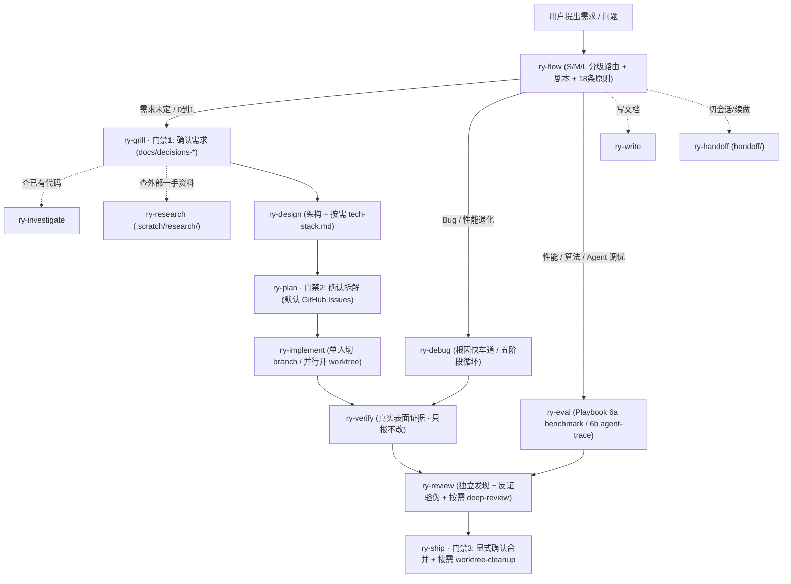

# ry-workflow

[English](README.md) | 简体中文

一套面向 **Codex + Antigravity**（兼容标准 Agent Skills 生态）的个人定制开发工作流，共 **20 个 Skill（1 个总控 + 13 个主流程/日常工具 + 6 个仅用户主动调用的专项工具）**。

融合了 [`windflow`](https://github.com/YinFengWindy/windflow) 的阶段门禁架构、[`pstack`](https://github.com/cursor/plugins/tree/main/pstack) 的工程原则/剧本与真实界面验证、[`mattpocock/skills`](https://github.com/mattpocock/skills) 的边聊边落盘/独立外部调研/硬核排错/双轴审查/PR 危险度，以及 [`nagi-studio/skills`](https://github.com/nagi-studio/skills) 的技术选型运维权责、UI 去味与项目大扫除实践。

```text
用 ry-flow 从 0 到 1 实现一个 personal agent：先对齐 MVP 范围和决策，再做选型与架构设计。
用 ry-research 调研 MCP 最新规范和主流 Agent SDK 的流式工具调用能力。
用 ry-debug 排查偶现的重复工具调用，先造稳定复现再分析根因。
用 ry-review 审查当前分支和 main 的差异，只给验证过的结论，不要改代码。
```

---

## 安装与使用

通过 `skills` CLI 安装：

```bash
# 安装整套全局 skills
npx skills@latest add siyuruolii/ry-workflow -g

# 或只装单个独立 skill（例如代码审查）
npx skills@latest add siyuruolii/ry-workflow --skill ry-review -g

# 也可仅安装到当前项目目录
npx skills@latest add siyuruolii/ry-workflow
```

所有原子 Skill 均带 `ry-` 前缀和 `metadata.collection: ry-workflow`，既可单独安装使用，也可由总控 `ry-flow` 串联编排。安装完成后重启会话或刷新技能列表，即可按名称（如 `ry-flow`、`ry-grill`、`ry-review`）调用。

---

## 20 个 Skill 速查表

### 总控与主流程 / 日常工具（14 个）

| 阶段 / 场景 | Skill | 核心作用 |
| :--- | :--- | :--- |
| **总控路由** | [`ry-flow`](skills/ry-flow/SKILL.md) | 按 `S/M/L` 规模分级路由阶段、按需加载剧本（含 Agent 评估、`AFK` 过夜跑与原型探路）与 18 条工程原则、守住三道人类门禁 |
| **需求对齐** | [`ry-grill`](skills/ry-grill/SKILL.md) | 支持轻量复述校准 / Prompt 打磨 / 换视角破局 + 决策树追问，在允许的仓库中边聊边落盘 `docs/decisions-*.md`、`GLOSSARY.md` 与高门槛 ADR |
| **代码溯源** | [`ry-investigate`](skills/ry-investigate/SKILL.md) | 内部仓库代码行为链与 Git/PR/ADR 历史溯源（只读不落盘；小查主线程，广查派只读 subagent） |
| **外部调研** | [`ry-research`](skills/ry-research/SKILL.md) | 官方文档/SDK/协议一手资料查证（联网 subagent 或父线程回退；纯事实存本地排除的 `.scratch/research/` 不污染 `docs/`） |
| **方案设计** | [`ry-design`](skills/ry-design/SKILL.md) | 模块架构设计 + 按需加载的技术选型（[`tech-stack.md`](skills/ry-design/references/tech-stack.md)）；常规直接收敛，高风险派 2+ 盲评候选 |
| **规划拆解** | [`ry-plan`](skills/ry-plan/SKILL.md) | 迷雾期超大项目先建决策地图（`wayfinder`），路径清晰后写 What 维度 Spec + GitHub Issue 去重 + 垂直切片（标 `Parallel / AFK / HITL`）；默认走 GitHub，离线退回 `docs/plans/` |
| **隔离实现** | [`ry-implement`](skills/ry-implement/SKILL.md) | 顺序开发切普通 task branch、并行写代码开独立 worktree（支持 DAG 就绪前沿汇入单集成分支或 Stacked PRs）；务实 TDD、依赖与不可逆变更核查、顺手清 diff 噪音 |
| **排错诊断** | [`ry-debug`](skills/ry-debug/SKILL.md) | 明显报错走根因快车道（禁 workaround）；疑难/偶现/性能退化走五阶段循环（先看真接缝回归测试挂红、修完回跑原始复现并留根因记录） |
| **真证据验收** | [`ry-verify`](skills/ry-verify/SKILL.md) | 按真实接触面（UI/CLI/API/库）驱动验证输出与副作用，打回垃圾测试，发现 `unmet` 只报不改 |
| **基准与 Agent 评估** | [`ry-eval`](skills/ry-eval/SKILL.md) | 冻结基线 + 单变量迭代（`decision.tsv`）+ 对比报告；按分支加载通用性能/算法（[`benchmark.md`](skills/ry-eval/references/benchmark.md)）或 AI Agent/Tool/Prompt/Harness Trace 盲评与 HTML 报告（[`agent-trace.md`](skills/ry-eval/references/agent-trace.md)） |
| **独立审查** | [`ry-review`](skills/ry-review/SKILL.md) | 独立发现（小 diff 单 finder、大/高危 diff 并行 + 按需加载 [`deep-review.md`](skills/ry-review/references/deep-review.md) 红队与代码坏味道）+ Diff 外爆炸半径实证 + 独立反证验伪 + 补丁必要性把关 |
| **发布交付** | [`ry-ship`](skills/ry-ship/SKILL.md) | 可视化 PR（含实证 Merge Danger 与 `one-way` 回滚说明）+ 当前 head CI + 显式授权合并；删 worktree 时按需加载 [`worktree-cleanup.md`](skills/ry-ship/references/worktree-cleanup.md) 防 Windows junction 误删 |
| **技术写作** | [`ry-write`](skills/ry-write/SKILL.md) | Diátaxis 文档写作 + 去 AI 废话 + 写给 Agent 看的文档与 Skill 试跑校验规范（仅文档/Skill 本身为交付物时触发） |
| **交接与恢复** | [`ry-handoff`](skills/ry-handoff/SKILL.md) | 跨会话/跨工具脱敏交接（存本地排除的 `handoff/`）+ 回来续做现场恢复（多分支/PR 汇总与待人类拍板项前置） |

### 仅用户主动调用的专项工具（6 个，`disable-model-invocation: true`）

以下 6 个 Skill **不会**被 `ry-flow` 或模型自动触发，只在你明确点名时执行（`ry-verify-create` 与 `ry-verify-maintain` 因触发时机与“维护态禁改产品代码”红线不同而刻意分离）：

| Skill | 核心作用 |
| :--- | :--- |
| [`ry-deslop`](skills/ry-deslop/SKILL.md) | UI 视觉减法清理（审美归用户，`DESIGN.md` 优先于默认清单） |
| [`ry-verify-create`](skills/ry-verify-create/SKILL.md) | 一次性为暂无验证能力的仓库生成项目本地 `.agents/skills/verify-<app>/` 与用户视角 Feature Map，并端到端实跑验通 |
| [`ry-verify-maintain`](skills/ry-verify-maintain/SKILL.md) | 定期巡检并同步已有项目本地验证 Skill 与 Feature Map（区分文档/脚本漂移与真实产品 Bug，绝不改产品代码） |
| [`ry-tidy`](skills/ry-tidy/SKILL.md) | 代码库脏了时做大扫除：收拢分散规则、清死代码/废话注释/旧文档、提议 5,000-token 钩子、`AGENTS.md` 瘦身 |
| [`ry-correct`](skills/ry-correct/SKILL.md) | 刚重复踩同一类坑时固化防呆：沿「架构 → 类型/Lint/钩子 → 行为测试 → `AGENTS.md` 规则表」提档并证伪新检查 |
| [`ry-retro`](skills/ry-retro/SKILL.md) | 结束一次长会话/里程碑后复盘：按严重度审计导航、自动化检查、规范分层、文档瘦身与 `ry-*` skill 措辞调优 |

---

## 整体流程与文档分层



- **三层文档分工（仅大功能/复杂架构且仓库规范允许时落盘，外部仓库或小改动内联）**：
  - `docs/decisions-<topic>.md` + `GLOSSARY.md`（产品拍板与统一术语，由 `ry-grill` 边聊边落盘）
  - `docs/design/<topic>.md`（技术选型、模块接口、**为什么这么设计与取舍**，由 `ry-design` 产出）
  - GitHub Issues 或 `docs/plans/<topic>.md`（**What**：验收标准与垂直切片拆解，链接前两层不重复抄写，由 `ry-plan` 产出）
- **两类临时目录（在业务仓库首次写入前优先通过 `.git/info/exclude` 本地忽略，不污染共享 `.gitignore`）**：`.scratch/`（外部调研纯事实 `research/`、评估实验与对比报告 `eval/`、设计盲评与一次性原型 `design/` / `prototypes/`、长任务审计日志 `decisions.tsv`）、`handoff/`（跨会话/跨工具脱敏交接稿）。

---

## 18 条可点名纠偏的工程原则

完整定义见 [`skills/ry-flow/references/principles.md`](skills/ry-flow/references/principles.md)。在任何对话里可直接用中/英文短名纠偏：

- **思考与范围**：`Laziness Protocol / 最小改动`、`Subtract Before You Add / 先减后加`、`Foundational Thinking / 先定数据形状`、`Attack the Premise / 挑战前提`、`First Principles / 第一性原理重设计`、`Build the Lever / 先造杠杆`、`Outcome-Oriented Execution / 直奔终态、迁完删旧`
- **架构与边界**：`Boundary Discipline / 边界校验、内部信任`、`Model the Domain / 用结构消除散落分支`、`Deep Modules / 深模块与低阅读负担`、`Make Operations Idempotent / 幂等收敛`、`Separate Before Serializing Shared State / 先隔离再加锁`
- **验证与排错**：`Prove It Works / 真证据交付`、`Fix Root Causes / 修根因不糊创可贴`、`Test Behavior, Not Implementation / 测行为不测实现`、`Explain the Number / 解释数字`
- **协作与进化**：`Guard the Context Window / 守卫上下文窗口`、`Encode Lessons in Structure / 把教训刻进结构`

---

## 维护与致谢

仓库维护不变量（渐进加载纪律、描述长度预算与刻意分离边界）见 [AGENTS.md](AGENTS.md)。上游参考与开源致谢见 [THIRD_PARTY_NOTICES.md](THIRD_PARTY_NOTICES.md) 和 [upstream-lock.json](upstream-lock.json)。MIT License 见 [LICENSE](LICENSE)。
